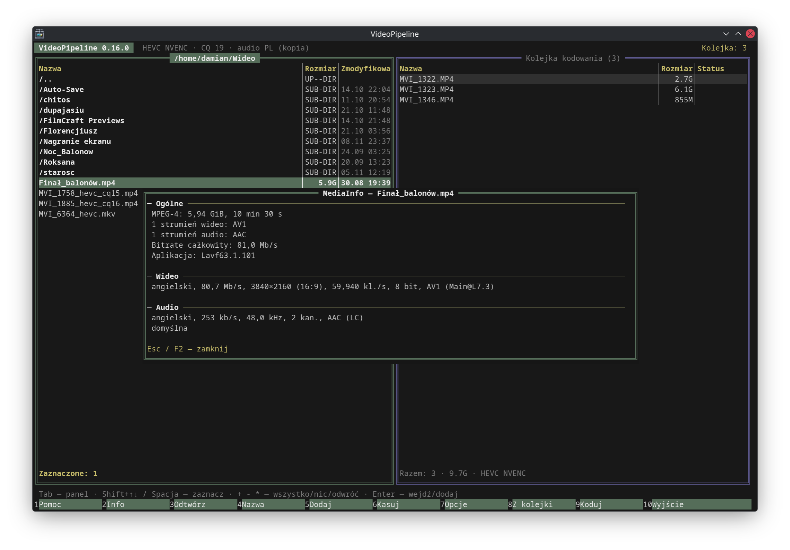
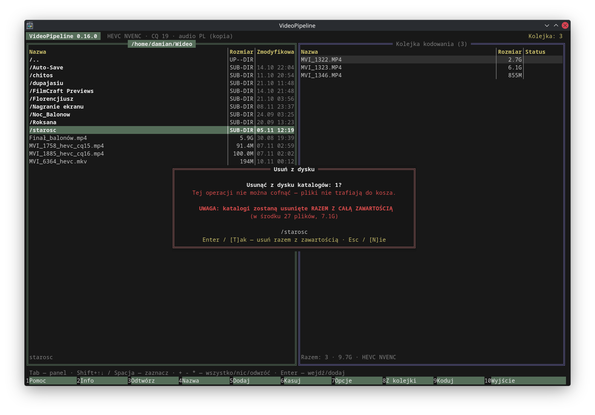

  

<h1 align="center">VIDEOPIPELINE</h1>

VideoPipeline kompresuje filmy do HEVC, AV1 albo AVC (H.264) na karcie graficznej: NVIDIA (NVENC) albo Intel (QSV, na Linuksie
zapasowo VAAPI). Działa na Linuksie i Windows. Ma interfejs terminalowy w stylu Midnight Commandera, a podany z plikami
działa jako zwykłe polecenie do skryptów.

Więcej zrzutów: [galeria](#galeria).

## Do czego służy

- **Kompresja nagrań i filmów** — materiał z aparatu, kamery czy płyt trafia do HEVC/AV1 i zajmuje kilka razy mniej miejsca;
  AVC (H.264) — gdy liczy się zgodność ze starszymi urządzeniami.
- **Zachowanie HDR** — HDR10 przechodzi bez zmian, a w HEVC także Dolby Vision (RPU) i HDR10+ (dynamiczne metadane).
- **Porządkowanie ścieżek** — domyślnie zostaje tylko polskie audio; opcjonalnie angielskie audio i napisy PL/EN,
  polska ścieżka może zostać przekodowana do E-AC-3 192 kb/s.
- **Kadrowanie** — automatyczne wykrywanie i usuwanie czarnych pasów (cropdetect).
- **Praca wsadowa** — kolejka wielu plików, dwa kodowania naraz, wznawianie przerwanej pracy.
- **Bezpieczne kopiowanie** — opcjonalna kopia wyniku obok źródła z weryfikacją SHA-512 (do 3 prób).

## Wymagany sprzęt i system

| Element | Wymaganie |
|---|---|
| Procesor | x86-64-v3 (AVX2, BMI2, FMA): Intel Haswell (4. gen. Core) / AMD Zen 1 lub nowszy |
| System | Linux z glibc 2.41+ (np. CachyOS/Arch, Debian 13, Ubuntu 25.04) — AppImage i deb; Windows 10/11 x64 — .zip |
| Karta NVIDIA | AVC i HEVC: GeForce GTX 10xx (Pascal) lub nowsza; AV1: RTX 40xx / 50xx. Sterownik 570 lub nowszy (`nvidia-smi` do monitora obciążenia) |
| Karta Intel | AVC i HEVC: Core 7. gen. (Kaby Lake) lub nowszy; AV1: Arc (A/B), Core Ultra (Meteor Lake) lub nowszy |
| Sterowniki Intel | Linux: `intel-media-driver` (iHD, VA-API) i runtime oneVPL: `vpl-gpu-rt` (Tiger Lake i nowsze) albo `intel-media-sdk` (starsze); na Debianie `intel-media-va-driver-non-free` i `libmfx-gen1.2`; użytkownik w grupie `render`. Windows: aktualny sterownik grafiki Intel (zawiera runtime oneVPL) |
| Miejsce na dysku | na wynik (pliki tymczasowe wideo tylko przy `--legacy-inject`) |

Wystarczy jedna karta. Gdy w komputerze są obie, domyślnie koduje NVIDIA, a Intela wybiera się jawnie (niżej).

## Instalacja

Gotowe pliki są na stronie [Releases](https://github.com/8brzrs26ws-cloud/videopipeline/releases). Każdy wariant zawiera
własne ffmpeg i ffprobe (NVENC i QSV; na Linuksie także VAAPI), mkvmerge, MediaInfo, dovi_tool i hdr10plus_tool; sterowniki GPU
pochodzą z systemu.

**AppImage** (dowolna dystrybucja spełniająca wymagania):

    chmod +x VideoPipeline-*-x86_64_v3.AppImage
    ./VideoPipeline-*-x86_64_v3.AppImage
    ./VideoPipeline-*-x86_64_v3.AppImage --appimage-extract-and-run   # gdy system nie ma FUSE

**Pakiet deb** (Debian 13, Ubuntu 25.04+) — instaluje się w `/opt/videopipeline`, dodaje polecenie `videopipeline`, wpis w menu i ikonę:

    sudo apt install ./videopipeline_*_amd64.deb

**Arch Linux / CachyOS** — pakiet pacmana, też do `/opt/videopipeline`, z poleceniem `videopipeline` i wpisem w menu:

    sudo pacman -U videopipeline-*-x86_64.pkg.tar.zst
    sudo pacman -R videopipeline              # odinstalowanie

Do kodowania na Intelu doinstaluj `intel-media-driver` i `vpl-gpu-rt`; na NVIDII wystarczy sterownik (`nvidia-utils`).

**Windows** — rozpakuj `VideoPipeline-*-windows-x86_64_v3.zip` i uruchom `videopipeline.exe` (dwuklik otwiera okno
konsoli; najlepiej wygląda w Windows Terminal). Wszystkie pliki muszą zostać w jednym folderze. Pliki nie są podpisane
cyfrowo, więc SmartScreen może poprosić o potwierdzenie. Pliki przeciągnięte na `videopipeline.exe` są od razu kodowane
(tryb skryptowy). U góry lewego panelu widać dyski z etykietami i wolnym miejscem.
`utworz-skrot.cmd` z paczki tworzy skrót „VideoPipeline” na pulpicie i w menu Start (zob. niżej: okno programu).

Sumy kontrolne leżą obok plików (`.sha256`).

### Okno programu i ikona na pasku zadań

Uruchomiony z menu aplikacji, dwuklikiem albo ze skrótu VideoPipeline otwiera się we własnym oknie: paczki
(AppImage, deb, Arch, Windows) zawierają terminal `videopipeline-term` — [Alacritty](https://github.com/alacritty/alacritty)
zbudowany ze źródeł z ikoną VideoPipeline i własną konfiguracją (`videopipeline-term.toml` obok programu).
Pasek zadań i ramka okna pokazują wtedy ikonę VideoPipeline — w KDE, GNOME, na X11 i Wayland oraz w Windows.

- Wpisane w otwartym terminalu `videopipeline` działa w tym terminalu (i z jego ikoną).
- Terminal wymaga OpenGL; gdy nie wystartuje (np. maszyna wirtualna, Pulpit zdalny), program użyje terminala
  z systemu (Konsole, GNOME Terminal, kitty… — Windows: konsola systemowa).
- Własny terminal zamiast dołączonego: `VIDEOPIPELINE_TERMINAL=kitty` (albo pełne polecenie, np. `"foot -e"`).
- Windows: `utworz-skrot.cmd` tworzy skrót na pulpicie i w menu Start (można go przypiąć do paska zadań).

## Użycie

### Interfejs (TUI)

Uruchomione bez argumentów (albo dwuklikiem — program otworzy okno terminala lub konsoli) pokazuje dwa panele:
po lewej pliki, po prawej kolejkę kodowania.

| Klawisz | Działanie |
|---|---|
| Tab | przełącz panel (pliki ↔ kolejka) |
| Enter / Backspace | wejdź do katalogu (lub dodaj plik) / katalog wyżej |
| Spacja, Ins | zaznacz / odznacz |
| Shift+↑↓ / PgUp / PgDn / Home / End | zaznaczanie wielu pozycji |
| `+` `-` `*` | zaznacz wszystko / wyczyść / odwróć |
| F2 | informacje o pliku (MediaInfo, w stylu widoku „Easy”): kontener, rozmiar, czas, każdy strumień wideo/audio/napisów w jednej linii; ↑↓ przewijanie, Esc zamyka |
| F3 | odtwórz plik (lewy panel) lub pozycję kolejki w [mpv](https://mpv.io) — tylko w TUI i w środowisku graficznym (X11/Wayland, Windows). mpv jest dołączony do paczek; przy buildzie ze źródeł używany jest mpv z systemu |
| F4 | zmień nazwę pliku lub katalogu w lewym panelu (kursor stoi przed rozszerzeniem — wygodne dopisanie np. `_v2`); przy kilku zaznaczonych plikach albo po Tab — **zmiana nazw wielu plików** (niżej) |
| F5 | dodaj zaznaczone do kolejki (katalog = wszystkie filmy w nim) |
| Ctrl+F | **znajdź plik** po fragmencie nazwy (niżej) |
| F6 | usuń zaznaczone (lub bieżący) pliki i katalogi z dysku w lewym panelu — po potwierdzeniu; przy katalogach okno ostrzega, ile plików i GB zniknie, potwierdzenie: Enter lub T, anulowanie: Esc lub N; gdy brakuje uprawnień, okno wyjaśnia, czego brakuje (właściciel, prawa zapisu) i podaje polecenie naprawy; katalogu głównego i domowego nie usuwa |
| F7 | opcje |
| F8 / Del | wyjmij z kolejki (plik zostaje na dysku) |
| F9 | koduj (Esc przerywa) |
| F10, Ctrl+C | wyjście |
| Ctrl+L | przerysuj ekran (gdy terminal zostawi resztki okna) |
| Mysz | klik — kursor i zaznaczenie pliku; podwójny klik — zaznaczone + kliknięty plik do kolejki (na katalogu: wejście); prawy klik — MediaInfo; kółko — przewijanie; klik na pasku F1–F10 — klawisz. Zaznaczanie tekstu w terminalu: z wciśniętym Shift |

U góry lewego panelu, przypięte i oddzielone linią od plików, są dyski — zawsze widoczne, niezależnie od przewinięcia:
na Windows litery z etykietami woluminów, na Linuksie zamontowane systemy plików (dyski, pendrive'y w `/run/media`,
udziały sieciowe, np. SMB z fstab) z etykietą; obok rozmiar i wolne miejsce. Enter na dysku przechodzi do niego.

**Ctrl+F — znajdź plik.** Szuka fragmentu nazwy (bez rozróżniania wielkości liter) od katalogu z lewego panelu,
z podkatalogami albo bez. Dopasowany fragment jest podkreślony; nazwy różniące się tylko wielkością liter (np. `Film.mkv`
i `film.mkv`) mają różne kolory — na Linuksie mogą leżeć nawet w jednym katalogu, na Windows (NTFS nie rozróżnia
wielkości liter) tylko w różnych. Wyniki można pokazać w oknie (przewijana lista, zaznaczanie jak w lewym panelu:
Spacja, klik, Shift+strzałki, `+ - *`; Enter albo podwójny klik dodaje do kolejki, na katalogu — przechodzi do niego)
i/lub od razu dodać wszystkie znalezione pliki wideo do kolejki. Do kolejki trafiają tylko pliki wideo. Esc zamyka okno,
ponowne Ctrl+F w tym samym katalogu wraca do wyników.

**F4 — zmiana nazw wielu plików.** Przy kilku zaznaczonych plikach F4 (albo Tab w zwykłym oknie zmiany nazwy) otwiera
zamianę fragmentów nazw: „Szukaj” (kilka wariantów oddzielonych `|`, np. `{|}` usuwa nawiasy: `{film}.mkv` → `film.mkv`),
„Zamień na” (puste = usuń), filtr rozszerzenia (np. `mkv`; puste = wszystkie) i opcja zamiany także w rozszerzeniu
(`.MP4` → `.mp4`). Zakres: zaznaczone pliki, a bez zaznaczenia — wszystkie pliki katalogu z danym rozszerzeniem.
Podgląd pokazuje starą i nową nazwę; konflikty (nazwa zajęta, ta sama nazwa dla kilku plików) są wyróżnione i pomijane.

**Przeciąganie plików.** Pliki wideo przeciągnięte z menedżera plików (Dolphin, Eksplorator…) na okno programu trafiają
do kolejki; katalogi i pliki innych typów są pomijane. Terminal przekazuje upuszczone pliki jako wklejone ścieżki —
działa w `videopipeline-term`, Konsole (wybierz „Wklej położenie”), kitty, GNOME Terminal i Windows Terminal.

Długa nazwa zaznaczonego pliku, która nie mieści się w kolumnie, przewija się sama, więc da się ją przeczytać
przy każdym rozmiarze okna.

**F7 — opcje.** Wiersz „Kodek wideo” przełącza między działającymi w systemie kombinacjami kodeka i karty,
np. `HEVC NVENC → AV1 NVENC → AVC NVENC → HEVC QSV`; pod listą widać, co wykryto. Pozostałe wiersze odpowiadają flagom z tabeli niżej.

**F9 — kodowanie.** Okno pokazuje postęp każdego pliku, prędkość, ETA, log i obciążenie sprzętu:

- NVIDIA: GPU, NVENC (koder), NVDEC (dekoder), VRAM — z `nvidia-smi`;
- Intel: VIDEO (blok VDBox, który sprzętowo koduje i dekoduje — stąd jedna wartość), FILTRY (kadrowanie, odszumianie
  i konwersja formatu; sterownik wykonuje je na VEBox albo na jednostkach EU, więc pokazane jest większe z obciążeń)
  i pamięć karty, liczone dla procesów ffmpeg, bez uprawnień administratora. Linux: `/proc/<pid>/fdinfo` (plus
  taktowanie karty), Windows: liczniki wydajności „GPU Engine”, te same co w Menedżerze zadań;
- zawsze CPU i RAM.

Zrzut na początku strony pokazuje kodowanie dwóch plików naraz (DUAL NVENC); Windows z Intel QSV — w [galerii](#galeria).

### Tryb skryptowy

Podanie plików lub katalogów pomija TUI: wszystko trafia do kolejki i kodowanie startuje od razu, z postępem
wypisywanym jako tekst.

    videopipeline film.mkv katalog/            # HEVC na domyślnej karcie
    videopipeline -av1 -c katalog/             # AV1 + kopia do <źródło>/encoded z weryfikacją SHA-512
    videopipeline --intel -q 22 film.mp4       # HEVC na karcie Intel, CQ 22
    videopipeline -b                           # bieżący katalog
    videopipeline --detect                     # pokaż wykryte enkodery i zakończ
    videopipeline --mediainfo film.mkv         # pełny raport MediaInfo (jak `mediainfo film.mkv`)

Kod wyjścia: 0 — sukces, 1 — błędy, 130 — przerwano (Ctrl+C). `--tui` z plikami otwiera TUI z wypełnioną kolejką.

### Wybór karty

Przy starcie program wykrywa enkodery krótkim kodowaniem testowym (sama obecność w ffmpeg nic nie znaczy).

- Tylko NVIDIA albo tylko Intel — używana jest ta karta, bez żadnych flag.
- Obie karty — domyślnie NVIDIA; Intel: `--intel` (QSV, a na Linuksie, gdy QSV nie działa — VAAPI) albo
  `--engine qsv|vaapi`.
- Na karcie Intel QSV dekoduje źródło sprzętowo (H.264, HEVC, AV1, VP9, MPEG-2, VC-1); kodek bez wsparcia sprzętowego
  jest dekodowany na CPU. VAAPI dekoduje przez VA-API. Na Windows QSV działa przez D3D11, a VAAPI nie istnieje.

### Opcje

| Flaga | Działanie |
|---|---|
| `-av1` | AV1 zamiast HEVC (zawsze 10-bit; bez Dolby Vision i HDR10+) |
| `-avc`, `--avc` | AVC (H.264) zamiast HEVC: profil High 8-bit SDR. Źródła HDR (HDR10, HLG, warstwa bazowa DV 8.1) są mapowane do SDR BT.709 (tone mapping, niżej); 10-bit SDR jest przeliczane do 8 bitów |
| `--intel`, `--engine nvenc\|qsv\|vaapi` | wybór karty (wyżej) |
| `-q N`, `--hevc-cq N`, `--av1-cq N`, `--avc-cq N` | jakość, 1–51, mniej = lepiej (domyślnie HEVC 19, AV1 25, AVC 18 — AVC potrzebuje niższego CQ do podobnej jakości) |
| `--qsv-preset P` | preset Intel QSV: `veryfast` … `veryslow` (domyślnie `slow`); `veryslow` na zintegrowanej grafice bywa kilka razy wolniejszy przy niewielkim zysku jakości |
| `--container auto\|mkv\|mp4` | kontener wyniku (domyślnie jak źródło); Dolby Vision i HDR10+ w obu |
| `-pleac3` | polska ścieżka → E-AC-3 stereo 192 kb/s |
| `-da` | dodatkowo angielskie audio (E-AC-3 5.1) oraz napisy EN i PL |
| `-d` | łagodne odszumianie (tylko źródła SDR 8-bit; CUDA, vpp_qsv / denoise_vaapi albo CPU) |
| `-pc` | bez wykrywania czarnych pasów (najdłuższy etap analizy) |
| `--1080p` | zmniejszenie obrazu do 1920×1080 z zachowaniem proporcji (po kadrowaniu, np. 3840×1600 → 1920×800); mniejsze źródła bez zmian. NVIDIA: na CPU (Lanczos) przed NVENC, Intel: `vpp_qsv` / `scale_vaapi` na karcie. Obszar aktywny Dolby Vision (L5) jest przeliczany. Nazwa wyniku dostaje `_1080p` |
| `--legacy-inject` | Dolby Vision / HDR10+ starą ścieżką: plik tymczasowy `.hevc`, dovi_tool / hdr10plus_tool i mkvmerge (domyślnie w locie, bez plików pośrednich) |
| `-pdv`, `-ph` | bez Dolby Vision / bez HDR10+ |
| `-c` | kopia wyniku do `<katalog źródła>/encoded` z weryfikacją SHA-512 |
| `-s` | wyłącz komputer po zakończeniu |
| `-b` | tryb skryptowy dla bieżącego katalogu |

**Jakość.** Ta sama wartość CQ trafia do każdej karty: NVENC `-cq`, QSV `-global_quality` (ICQ), VAAPI `-qp` (CQP;
dla AV1 przeliczone ×5 na skalę 0–255). Skale enkoderów nie są identyczne, więc ten sam CQ na różnych kartach daje
podobną, ale nie taką samą jakość i rozmiar. AVC ma te same priorytety jakości co HEVC: na NVENC preset p7, tune hq, VBR z CQ,
adaptacyjna kwantyzacja przestrzenna i czasowa, B-klatki referencyjne, pełny multipass, lookahead 32 klatek i CABAC;
na Intelu profil High z ICQ (QSV) albo CQP (VAAPI).

**Mapowanie tonów HDR → SDR (AVC).** AVC jest 8-bitowe, więc film HDR trzeba przeliczyć do SDR, inaczej wyglądałby
wyprano i z pasmami. Krzywa Hable bez desaturacji, wynik BT.709. Liczone na karcie, gdy się da: NVIDIA — `tonemap_opencl`
(wymaga OpenCL sterownika: na Linuksie pakiet `opencl-nvidia` / `nvidia-opencl-icd`, na Windows jest w sterowniku),
Intel — `vpp_qsv` / `tonemap_vaapi`; zapasowo na CPU (`zscale` + `tonemap`, wolniej przy 4K). Który wariant działa,
program sprawdza przed kodowaniem i pisze w logu. Profil Dolby Vision 5 (bez warstwy HDR10) nie jest obsługiwany.

**Pliki wynikowe** trafiają do `~/Wideo` (zmiana w F7). Kontener domyślnie wynika ze źródła (`.mp4` → `.mp4`, wszystko
inne → `.mkv`); w F7 albo `--container` można wymusić MKV lub MP4. Do MP4 audio w kodekach spoza MP4 (np. DTS,
TrueHD) jest przekodowywane do E-AC-3 640k, napisy tekstowe do mov_text, a obrazkowe (PGS) są pomijane.
Nazwa zawiera kodek i opcje, np. `film_hevc.mkv`, `film_hevc_qsv_cq22.mkv`, `film_av1_10bit_cq23_da.mkv`, więc wyniki
z różnymi ustawieniami się nie nadpisują.

**Analiza Dolby Vision i HDR10+** czyta strumień wideo raz dla obu narzędzi (dovi_tool i hdr10plus_tool dostają
te same dane), a okno analizy pokazuje postęp odczytu: procent, pozycję w filmie, prędkość i szacowany czas do końca.

**Bez plików tymczasowych.** ffmpeg koduje wideo i od razu zapisuje plik wynikowy razem z audio (kopia, a E-AC-3
z `-pleac3` / `-da` w locie) i napisami — bez pośrednich plików `.hevc`/`.eac3` i bez osobnego muksowania. Do czasu
ukończenia plik ma końcówkę `.part`.

**Dolby Vision i HDR10+ w locie.** Przy źródłach z DV / HDR10+ (HEVC) koder wysyła surowy strumień HEVC do programu,
który dokleja do każdej klatki jej RPU Dolby Vision i SEI HDR10+ (biblioteki z dovi_tool i hdr10plus_tool), a drugi
ffmpeg od razu składa z tego plik wynikowy z audio i napisami. Metadane trafiają do klatek według kolejności wyświetlania,
tak samo jak w `dovi_tool inject-rpu` / `hdr10plus_tool inject` — wynik jest identyczny jak przy starej ścieżce, a plik
ma rekord konfiguracji DV (dvcC/dvvC) w MKV i w MP4. RPU profilu 7 (dwie warstwy) są przerabiane na 8.1, bo kodowana
jest tylko warstwa bazowa. Stara ścieżka (plik tymczasowy `.hevc` → hdr10plus_tool → dovi_tool → mkvmerge) jest dostępna
w F7 albo przez `--legacy-inject`; jej pliki pośrednie są usuwane zaraz po udanym kolejnym kroku, a przerwane kodowanie
wznawia się od ostatniego ukończonego etapu.

## Galeria

Wszystkie zrzuty pochodzą z wersji 0.16.0 (Linux, KDE Plasma, okno `videopipeline-term`), poza zdjęciem z Windows.
Kliknij miniaturę, żeby zobaczyć pełny rozmiar.

<table>
  <tr>
    <td align="center" width="50%">
       
      Panele: pliki (lewy) i kolejka kodowania (prawy)
    </td>
    <td align="center" width="50%">
       
      F9 — kodowanie: postęp, fps, ETA, obciążenie GPU/NVENC/NVDEC, log
    </td>
  </tr>
  <tr>
    <td align="center">
       
      F2 — informacje o pliku (MediaInfo)
    </td>
    <td align="center">
       
      F7 — opcje: kodek i karta, jakość, audio, katalog wyjściowy
    </td>
  </tr>
  <tr>
    <td align="center">
       
      F6 — usuwanie z ostrzeżeniem o zawartości katalogu
    </td>
    <td align="center">
       
      Windows 11, Core Ultra 5 225H (Intel Arc): HEVC QSV, ok. 90 fps
    </td>
  </tr>
</table>

## Budowanie ze źródeł

### Wersja deweloperska

Potrzebne: Rust (stable) oraz w `PATH`: ffmpeg i ffprobe z obsługą wybranej karty (NVENC/CUDA albo QSV/VAAPI),
mkvmerge (mkvtoolnix), mediainfo, mpv (opcjonalnie, dla F3), [dovi_tool](https://github.com/quietvoid/dovi_tool), [hdr10plus_tool](https://github.com/quietvoid/hdr10plus_tool).

    ./install-build-deps.sh --dev   # raz: Rust (rustup), ffmpeg, mkvtoolnix, mediainfo, mpv (Arch, Debian)
    ./build.sh       # target/release/videopipeline + libvideopipeline_core.so
    ./install.sh     # opcjonalnie: ~/.local/bin (z biblioteką libstd Rusta), ikona i wpis w menu
    ./uninstall.sh   # usuwa to, co zainstalował install.sh

Program to biblioteka z całą logiką (`core/`) i binarka z interfejsem (`app/`). Oba pliki muszą pochodzić z jednego builda
i leżeć w tym samym katalogu (albo binarka w `bin/`, biblioteka w `../lib/`).

### Wydania: AppImage, deb i Windows (Docker)

Wydania buduje się w kontenerze Debian 13, więc wynik nie zależy od systemu, na którym budujesz. Wersja dla Windows
powstaje tam przez kroskompilację (MinGW-w64, cel Rusta `x86_64-pc-windows-gnu`): aplikacja, dovi_tool, hdr10plus_tool,
dav1d, libvpl i ffmpeg są kompilowane ze źródeł, a mkvmerge pochodzi z oficjalnej wersji przenośnej MKVToolNix.
Odtwarzacz mpv (F3) dla Linuksa jest kompilowany ze źródeł; dla Windows dołączany jest gotowy build
[shinchiro/mpv-winbuild-cmake](https://github.com/shinchiro/mpv-winbuild-cmake) (x86-64-v3), bo kroskompilacja mpv
z całym drzewem zależności byłaby bardzo długa.

    ./install-build-deps.sh     # raz: Docker, git, gh (Arch/CachyOS, Debian/Ubuntu); potem wyloguj się i zaloguj
    ./build-local.sh            # dist/: AppImage, deb, pakiet Arch, .zip dla Windows i sumy .sha256; cache w ./build
    ./build-local.sh linux      # tylko AppImage, deb i pakiet Arch
    ./build-local.sh windows    # tylko Windows
    ./release.sh vX.Y.Z         # wysyła pliki tej wersji z dist/ do GitHub Releases (wymaga gh auth login)

Zmienne dla `build-local.sh`:

| Zmienna | Znaczenie |
|---|---|
| `FFMPEG_VERSION` | wersja ffmpeg, domyślnie `latest` (najnowsze wydanie) |
| `DOVI_TOOL_REF`, `HDR10PLUS_TOOL_REF` | tagi narzędzi (domyślnie przypięte), `latest` = najnowsze |
| `INTEL` | Linux: `auto` (domyślnie), `1` — wymagaj QSV/VAAPI, `0` — bez Intela |
| `DAV1D_REF`, `LIBVPL_REF`, `MKVTOOLNIX_VERSION`, `MEDIAINFO_VERSION` | Windows: wersje bibliotek, MKVToolNix i MediaInfo, domyślnie `latest` |
| `MPV_VERSION` | Linux: wersja mpv budowanego ze źródeł (np. `0.41.0`), domyślnie `latest` |
| `LIBPLACEBO_REF` | Linux: wersja libplacebo budowanej razem z mpv, domyślnie `latest` (najnowsza zgodna z wymaganiem mpv) |
| `ALACRITTY_VERSION` | wersja Alacritty (terminal `videopipeline-term`), domyślnie `latest` |
| `MPV_WIN_TAG` | Windows: tag wydania shinchiro (data, np. `20261108`), domyślnie `latest` |
| `TARGET_CPU` | domyślnie `x86-64-v3` |
| `FORCE=1` | przebuduj ffmpeg i narzędzia mimo cache |
| `DOCKER=podman` | Podman zamiast Dockera |

### Budowanie na Windows (WSL)

Na komputerze z Windows paczki buduje się w WSL tym samym `./build-local.sh` (Docker działa w WSL, kontener jest ten sam).

1. PowerShell jako administrator: `wsl --install -d Debian`, potem w Debianie włącz systemd:
   `printf '[boot]\nsystemd=true\n' | sudo tee /etc/wsl.conf` i w PowerShellu `wsl --shutdown`.
2. W Debianie: `./install-build-deps.sh` (Docker, git, gh), ponownie `wsl --shutdown`, potem `./build-local.sh windows`.
3. Test: `unzip -o dist/VideoPipeline-*-windows-x86_64_v3.zip -d /mnt/c/VideoPipeline-test`.

Repozytorium trzymaj na systemie plików Linuksa — na dyskach Windows (`/mnt/c`, `/mnt/e`) git i build są wielokrotnie
wolniejsze. Przy dual boocie można użyć repozytorium i cache z partycji Linuksa: `tools\wsl\mount-linux.cmd`
(uruchamia się jako administrator) wyszukuje dyski z partycjami Linuksa, podłącza je do WSL, rozpoznaje system plików
(ext4, btrfs, xfs, f2fs) i montuje je przez sam WSL w `/mnt/wsl/PHYSICALDRIVE<n>p<m>` (widoczne we wszystkich
sesjach), z dowiązaniami `/mnt/linux/<etykieta>`; na końcu pokazuje katalogi domowe i znalezione repozytoria.
`tools\wsl\mount-linux.cmd -Unmount` odłącza dyski. Ograniczenia: WSL nie podłączy dysku, na którym jest Windows;
podłączony dysk znika z Windows na czas montowania; Linux musi być zamknięty normalnie (nie hibernacja).

To samo robi ręcznie uruchamiany workflow GitHub Actions (`.github/workflows/release.yml`).
Licencje dołączonych składników: [`packaging/appimage/THIRD-PARTY-NOTICES.md`](packaging/appimage/THIRD-PARTY-NOTICES.md).

## Licencja

GNU GPL v3 — zob. [`LICENSE`](LICENSE).
