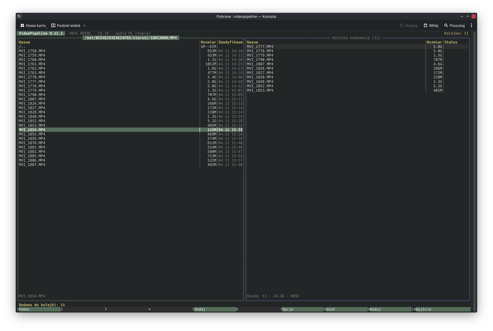
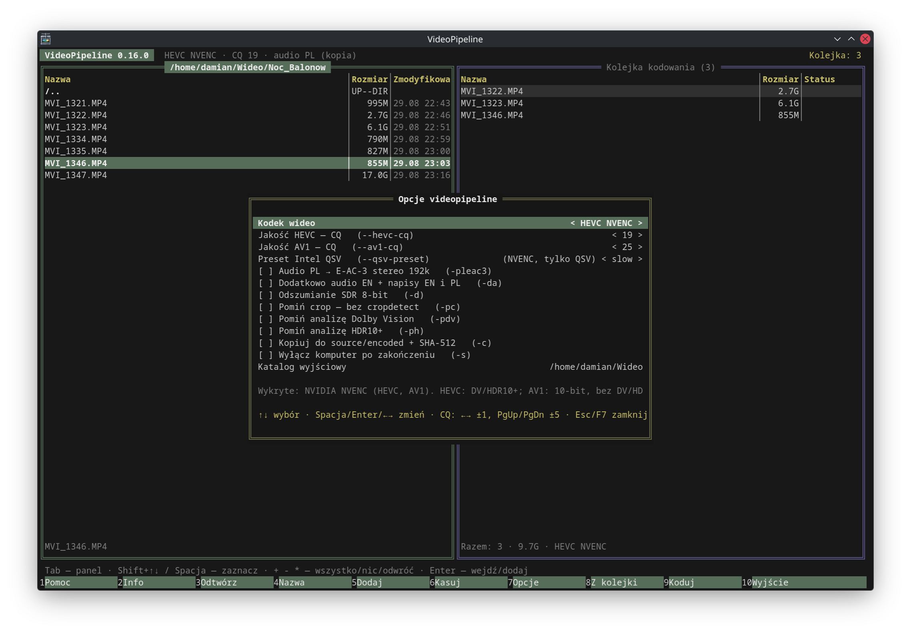
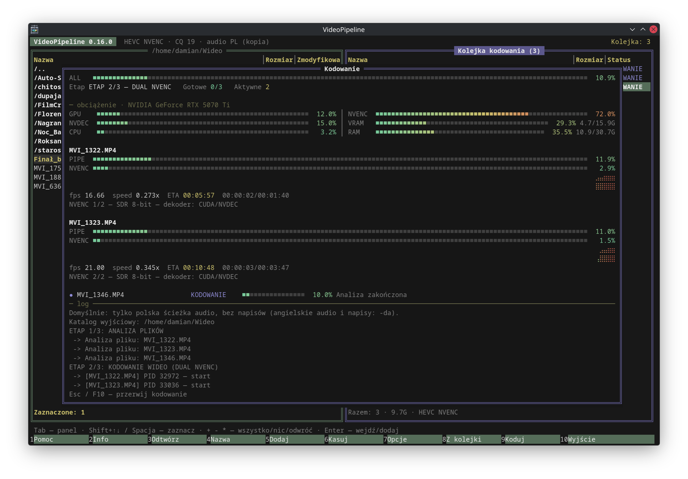
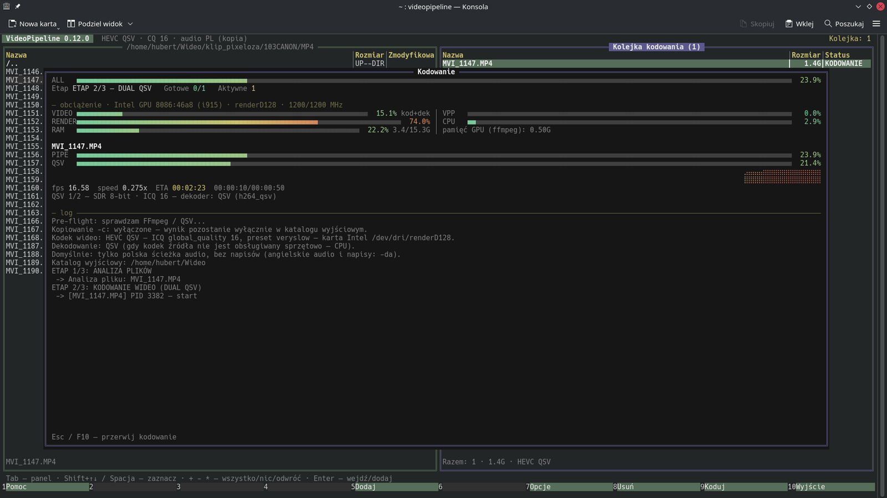
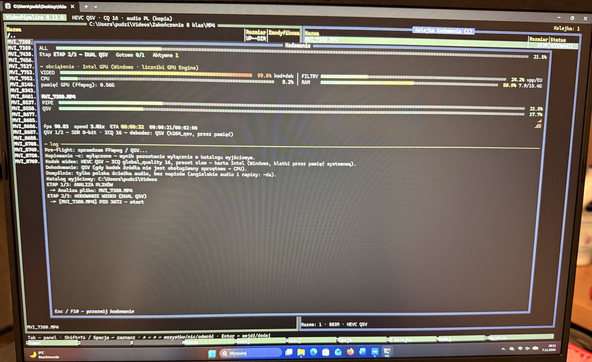

# VideoPipeline

VideoPipeline kompresuje filmy do HEVC albo AV1 na karcie graficznej: NVIDIA (NVENC) albo Intel (QSV, na Linuksie
zapasowo VAAPI). Działa na Linuksie i Windows. Ma interfejs terminalowy w stylu Midnight Commandera, a podany z plikami
działa jako zwykłe polecenie do skryptów.

## Do czego służy

- **Kompresja nagrań i filmów** — materiał z aparatu, kamery czy płyt trafia do HEVC/AV1 i zajmuje kilka razy mniej miejsca.
- **Zachowanie HDR** — HDR10 przechodzi bez zmian, a w HEVC także Dolby Vision (RPU) i HDR10+ (dynamiczne metadane).
- **Porządkowanie ścieżek** — domyślnie zostaje tylko polskie audio; opcjonalnie angielskie audio i napisy PL/EN,
  polska ścieżka może zostać przekodowana do E-AC-3 192 kb/s.
- **Kadrowanie** — automatyczne wykrywanie i usuwanie czarnych pasów (cropdetect).
- **Praca wsadowa** — kolejka wielu plików, dwa kodowania naraz, wznawianie przerwanej pracy.
- **Bezpieczne kopiowanie** — opcjonalna kopia wyniku obok źródła z weryfikacją SHA-512 (do 3 prób).

## Wymagany sprzęt i system

| Element | Wymaganie |
|---|---|
| Procesor | x86-64-v3 (AVX2, BMI2, FMA): Intel Haswell (4. gen. Core) / AMD Zen 1 lub nowszy |
| System | Linux z glibc 2.41+ (np. CachyOS/Arch, Debian 13, Ubuntu 25.04) — AppImage i deb; Windows 10/11 x64 — .zip |
| Karta NVIDIA | HEVC: GeForce GTX 10xx (Pascal) lub nowsza; AV1: RTX 40xx / 50xx. Sterownik 570 lub nowszy (`nvidia-smi` do monitora obciążenia) |
| Karta Intel | HEVC: Core 7. gen. (Kaby Lake) lub nowszy; AV1: Arc (A/B), Core Ultra (Meteor Lake) lub nowszy |
| Sterowniki Intel | Linux: `intel-media-driver` (iHD, VA-API) i runtime oneVPL: `vpl-gpu-rt` (Tiger Lake i nowsze) albo `intel-media-sdk` (starsze); na Debianie `intel-media-va-driver-non-free` i `libmfx-gen1.2`; użytkownik w grupie `render`. Windows: aktualny sterownik grafiki Intel (zawiera runtime oneVPL) |
| Miejsce na dysku | wolne miejsce w katalogu wyjściowym na pliki tymczasowe (rzędu rozmiaru wyniku) |

Wystarczy jedna karta. Gdy w komputerze są obie, domyślnie koduje NVIDIA, a Intela wybiera się jawnie (niżej).

## Instalacja

Gotowe pliki są na stronie [Releases](https://github.com/8brzrs26ws-cloud/videopipeline/releases). Każdy wariant zawiera
własne ffmpeg i ffprobe (NVENC i QSV; na Linuksie także VAAPI), mkvmerge, MediaInfo, dovi_tool i hdr10plus_tool; sterowniki GPU
pochodzą z systemu.

**AppImage** (dowolna dystrybucja spełniająca wymagania):

    chmod +x VideoPipeline-*-x86_64_v3.AppImage
    ./VideoPipeline-*-x86_64_v3.AppImage
    ./VideoPipeline-*-x86_64_v3.AppImage --appimage-extract-and-run   # gdy system nie ma FUSE

**Pakiet deb** (Debian 13, Ubuntu 25.04+) — instaluje się w `/opt/videopipeline`, dodaje polecenie `videopipeline`, wpis w menu i ikonę:

    sudo apt install ./videopipeline_*_amd64.deb

**Arch Linux / CachyOS** — pakiet pacmana, też do `/opt/videopipeline`, z poleceniem `videopipeline` i wpisem w menu:

    sudo pacman -U videopipeline-*-x86_64.pkg.tar.zst
    sudo pacman -R videopipeline              # odinstalowanie

Do kodowania na Intelu doinstaluj `intel-media-driver` i `vpl-gpu-rt`; na NVIDII wystarczy sterownik (`nvidia-utils`).

**Windows** — rozpakuj `VideoPipeline-*-windows-x86_64_v3.zip` i uruchom `videopipeline.exe` (dwuklik otwiera okno
konsoli; najlepiej wygląda w Windows Terminal). Wszystkie pliki muszą zostać w jednym folderze. Pliki nie są podpisane
cyfrowo, więc SmartScreen może poprosić o potwierdzenie. Pliki przeciągnięte na `videopipeline.exe` są od razu kodowane
(tryb skryptowy). W lewym panelu, w katalogu głównym dysku, widać pozostałe dyski.

Sumy kontrolne leżą obok plików (`.sha256`).

## Użycie

### Interfejs (TUI)

Uruchomione bez argumentów (albo dwuklikiem — program otworzy okno terminala lub konsoli) pokazuje dwa panele:
po lewej pliki, po prawej kolejkę kodowania.

| Klawisz | Działanie |
|---|---|
| Tab | przełącz panel (pliki ↔ kolejka) |
| Enter / Backspace | wejdź do katalogu (lub dodaj plik) / katalog wyżej |
| Spacja, Ins | zaznacz / odznacz |
| Shift+↑↓ / PgUp / PgDn / Home / End | zaznaczanie wielu pozycji |
| `+` `-` `*` | zaznacz wszystko / wyczyść / odwróć |
| F2 | informacje o pliku (MediaInfo, w stylu widoku „Easy”): kontener, rozmiar, czas, każdy strumień wideo/audio/napisów w jednej linii; ↑↓ przewijanie, Esc zamyka |
| F3 | odtwórz plik (lewy panel) lub pozycję kolejki w [mpv](https://mpv.io) — tylko w TUI i w środowisku graficznym (X11/Wayland, Windows). mpv jest dołączony do paczek; przy buildzie ze źródeł używany jest mpv z systemu |
| F4 | zmień nazwę pliku lub katalogu w lewym panelu (kursor stoi przed rozszerzeniem — wygodne dopisanie np. `_v2`) |
| F5 | dodaj zaznaczone do kolejki (katalog = wszystkie filmy w nim) |
| F6 | usuń zaznaczone (lub bieżący) pliki i katalogi z dysku w lewym panelu — po potwierdzeniu; przy katalogach okno ostrzega, ile plików i GB zniknie, potwierdzenie: Enter lub T, anulowanie: Esc lub N; gdy brakuje uprawnień, okno wyjaśnia, czego brakuje (właściciel, prawa zapisu) i podaje polecenie naprawy; katalogu głównego i domowego nie usuwa |
| F7 | opcje |
| F8 / Del | wyjmij z kolejki (plik zostaje na dysku) |
| F9 | koduj (Esc przerywa) |
| F10, Ctrl+C | wyjście |
| Ctrl+L | przerysuj ekran (gdy terminal zostawi resztki okna) |
| Mysz | klik — kursor i zaznaczenie pliku; podwójny klik — zaznaczone + kliknięty plik do kolejki (na katalogu: wejście); prawy klik — MediaInfo; kółko — przewijanie; klik na pasku F1–F10 — klawisz. Zaznaczanie tekstu w terminalu: z wciśniętym Shift |

Długa nazwa zaznaczonego pliku, która nie mieści się w kolumnie, przewija się sama, więc da się ją przeczytać
przy każdym rozmiarze okna.

**F7 — opcje.** Wiersz „Kodek wideo” przełącza między działającymi w systemie kombinacjami kodeka i karty,
np. `HEVC NVENC → AV1 NVENC → HEVC QSV`; pod listą widać, co wykryto. Pozostałe wiersze odpowiadają flagom z tabeli niżej.

**F9 — kodowanie.** Okno pokazuje postęp każdego pliku, prędkość, ETA, log i obciążenie sprzętu:

- NVIDIA: GPU, NVENC (koder), NVDEC (dekoder), VRAM — z `nvidia-smi`;
- Intel: VIDEO (blok VDBox, który sprzętowo koduje i dekoduje — stąd jedna wartość), FILTRY (kadrowanie, odszumianie
  i konwersja formatu; sterownik wykonuje je na VEBox albo na jednostkach EU, więc pokazane jest większe z obciążeń)
  i pamięć karty, liczone dla procesów ffmpeg, bez uprawnień administratora. Linux: `/proc/<pid>/fdinfo` (plus
  taktowanie karty), Windows: liczniki wydajności „GPU Engine”, te same co w Menedżerze zadań;
- zawsze CPU i RAM.

Linux, kodowanie na karcie Intel (HEVC QSV, Iris Xe w Core i5-1235U, dekodowanie `h264_qsv`):

Windows 11, Core Ultra 5 225H (Intel Arc): HEVC QSV z dekodowaniem `h264_qsv`, ok. 90 fps, monitor z liczników
„GPU Engine”:

### Tryb skryptowy

Podanie plików lub katalogów pomija TUI: wszystko trafia do kolejki i kodowanie startuje od razu, z postępem
wypisywanym jako tekst.

    videopipeline film.mkv katalog/            # HEVC na domyślnej karcie
    videopipeline -av1 -c katalog/             # AV1 + kopia do <źródło>/encoded z weryfikacją SHA-512
    videopipeline --intel -q 22 film.mp4       # HEVC na karcie Intel, CQ 22
    videopipeline -b                           # bieżący katalog
    videopipeline --detect                     # pokaż wykryte enkodery i zakończ
    videopipeline --mediainfo film.mkv         # pełny raport MediaInfo (jak `mediainfo film.mkv`)

Kod wyjścia: 0 — sukces, 1 — błędy, 130 — przerwano (Ctrl+C). `--tui` z plikami otwiera TUI z wypełnioną kolejką.

### Wybór karty

Przy starcie program wykrywa enkodery krótkim kodowaniem testowym (sama obecność w ffmpeg nic nie znaczy).

- Tylko NVIDIA albo tylko Intel — używana jest ta karta, bez żadnych flag.
- Obie karty — domyślnie NVIDIA; Intel: `--intel` (QSV, a na Linuksie, gdy QSV nie działa — VAAPI) albo
  `--engine qsv|vaapi`.
- Na karcie Intel QSV dekoduje źródło sprzętowo (H.264, HEVC, AV1, VP9, MPEG-2, VC-1); kodek bez wsparcia sprzętowego
  jest dekodowany na CPU. VAAPI dekoduje przez VA-API. Na Windows QSV działa przez D3D11, a VAAPI nie istnieje.

### Opcje

| Flaga | Działanie |
|---|---|
| `-av1` | AV1 zamiast HEVC (zawsze 10-bit; bez Dolby Vision i HDR10+) |
| `--intel`, `--engine nvenc\|qsv\|vaapi` | wybór karty (wyżej) |
| `-q N`, `--hevc-cq N`, `--av1-cq N` | jakość, 1–51, mniej = lepiej (domyślnie HEVC 19, AV1 25) |
| `--qsv-preset P` | preset Intel QSV: `veryfast` … `veryslow` (domyślnie `slow`); `veryslow` na zintegrowanej grafice bywa kilka razy wolniejszy przy niewielkim zysku jakości |
| `-pleac3` | polska ścieżka → E-AC-3 stereo 192 kb/s |
| `-da` | dodatkowo angielskie audio (E-AC-3 5.1) oraz napisy EN i PL |
| `-d` | łagodne odszumianie (tylko źródła SDR 8-bit; CUDA, vpp_qsv / denoise_vaapi albo CPU) |
| `-pc` | bez wykrywania czarnych pasów (najdłuższy etap analizy) |
| `-pdv`, `-ph` | bez Dolby Vision / bez HDR10+ |
| `-c` | kopia wyniku do `<katalog źródła>/encoded` z weryfikacją SHA-512 |
| `-s` | wyłącz komputer po zakończeniu |
| `-b` | tryb skryptowy dla bieżącego katalogu |

**Jakość.** Ta sama wartość CQ trafia do każdej karty: NVENC `-cq`, QSV `-global_quality` (ICQ), VAAPI `-qp` (CQP;
dla AV1 przeliczone ×5 na skalę 0–255). Skale enkoderów nie są identyczne, więc ten sam CQ na różnych kartach daje
podobną, ale nie taką samą jakość i rozmiar.

**Pliki wynikowe** trafiają do `~/Wideo` (zmiana w F7). Kontener wynika ze źródła: `.mp4` → `.mp4`, wszystko inne → `.mkv`.
Nazwa zawiera kodek i opcje, np. `film_hevc.mkv`, `film_hevc_qsv_cq22.mkv`, `film_av1_10bit_cq23_da.mkv`, więc wyniki
z różnymi ustawieniami się nie nadpisują. Przerwane kodowanie wznawia się od ostatniego ukończonego etapu.
W MP4 Dolby Vision zostaje w strumieniu, ale bez rekordu konfiguracji — część odtwarzaczy pokaże wtedy zwykły HDR10.

## Budowanie ze źródeł

### Wersja deweloperska

Potrzebne: Rust (stable) oraz w `PATH`: ffmpeg i ffprobe z obsługą wybranej karty (NVENC/CUDA albo QSV/VAAPI),
mkvmerge (mkvtoolnix), mediainfo, mpv (opcjonalnie, dla F3), [dovi_tool](https://github.com/quietvoid/dovi_tool), [hdr10plus_tool](https://github.com/quietvoid/hdr10plus_tool).

    ./build.sh       # target/release/videopipeline + libvideopipeline_core.so
    ./install.sh     # opcjonalnie: ~/.local/bin (z biblioteką libstd Rusta), ikona i wpis w menu
    ./uninstall.sh   # usuwa to, co zainstalował install.sh

Program to biblioteka z całą logiką (`core/`) i binarka z interfejsem (`app/`). Oba pliki muszą pochodzić z jednego builda
i leżeć w tym samym katalogu (albo binarka w `bin/`, biblioteka w `../lib/`).

### Wydania: AppImage, deb i Windows (Docker)

Wydania buduje się w kontenerze Debian 13, więc wynik nie zależy od systemu, na którym budujesz. Wersja dla Windows
powstaje tam przez kroskompilację (MinGW-w64, cel Rusta `x86_64-pc-windows-gnu`): aplikacja, dovi_tool, hdr10plus_tool,
dav1d, libvpl i ffmpeg są kompilowane ze źródeł, a mkvmerge pochodzi z oficjalnej wersji przenośnej MKVToolNix.
Odtwarzacz mpv (F3) dla Linuksa jest kompilowany ze źródeł; dla Windows dołączany jest gotowy build
[shinchiro/mpv-winbuild-cmake](https://github.com/shinchiro/mpv-winbuild-cmake) (x86-64-v3), bo kroskompilacja mpv
z całym drzewem zależności byłaby bardzo długa.

    ./install-build-deps.sh     # raz: Docker, git, gh (Arch/CachyOS, Debian/Ubuntu); potem wyloguj się i zaloguj
    ./build-local.sh            # dist/: AppImage, deb, pakiet Arch, .zip dla Windows i sumy .sha256; cache w ./build
    ./build-local.sh linux      # tylko AppImage, deb i pakiet Arch
    ./build-local.sh windows    # tylko Windows
    ./release.sh vX.Y.Z         # wysyła pliki tej wersji z dist/ do GitHub Releases (wymaga gh auth login)

Zmienne dla `build-local.sh`:

| Zmienna | Znaczenie |
|---|---|
| `FFMPEG_VERSION` | wersja ffmpeg, domyślnie `latest` (najnowsze wydanie) |
| `DOVI_TOOL_REF`, `HDR10PLUS_TOOL_REF` | tagi narzędzi (domyślnie przypięte), `latest` = najnowsze |
| `INTEL` | Linux: `auto` (domyślnie), `1` — wymagaj QSV/VAAPI, `0` — bez Intela |
| `DAV1D_REF`, `LIBVPL_REF`, `MKVTOOLNIX_VERSION`, `MEDIAINFO_VERSION` | Windows: wersje bibliotek, MKVToolNix i MediaInfo, domyślnie `latest` |
| `MPV_VERSION` | Linux: wersja mpv budowanego ze źródeł (np. `0.41.0`), domyślnie `latest` |
| `MPV_WIN_TAG` | Windows: tag wydania shinchiro (data, np. `20261108`), domyślnie `latest` |
| `TARGET_CPU` | domyślnie `x86-64-v3` |
| `FORCE=1` | przebuduj ffmpeg i narzędzia mimo cache |
| `DOCKER=podman` | Podman zamiast Dockera |

To samo robi ręcznie uruchamiany workflow GitHub Actions (`.github/workflows/release.yml`).
Licencje dołączonych składników: [`packaging/appimage/THIRD-PARTY-NOTICES.md`](packaging/appimage/THIRD-PARTY-NOTICES.md).

## Licencja

GNU GPL v3 — zob. [`LICENSE`](LICENSE).
